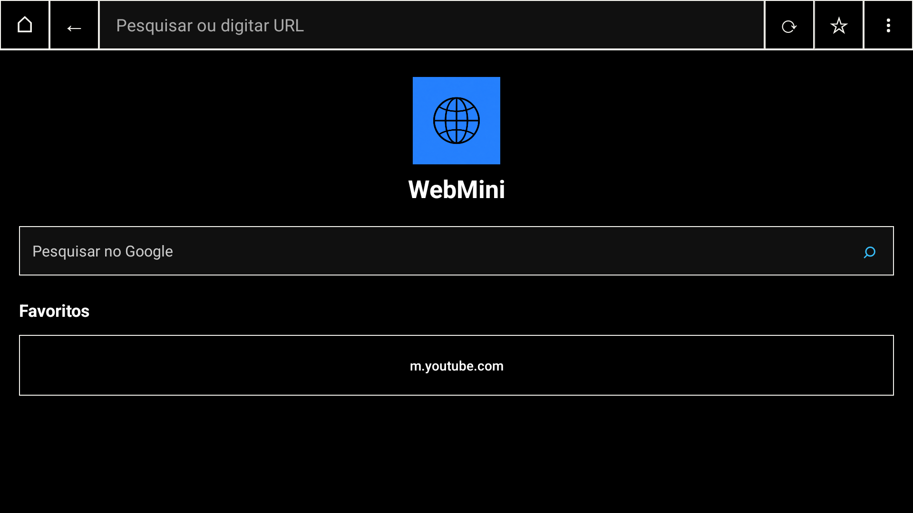

# WebMini

WebMini is a lightweight, single-tab web browser for Android phones and TVs, built on Android System WebView.


## Screenshots

| Favorites | Video playback |
| --- | --- |
|  |  |

## Features

- One WebView at a time, with a native Android interface.
- Google search, address bar, back, forward, reload, and local favorites.
- Android TV pointer controlled by the remote; it fades after inactivity.
- Optional network request filtering using EasyList and EasyPrivacy.
- Pop-up confirmation, download confirmation, and HTTP warnings.
- Cookies are managed by Android System WebView and persist between sessions.
- Interface language follows the Android device: English, Spanish, or Brazilian Portuguese. English is the fallback.
- No browsing history or password manager.

Filtering is based on network requests and does not remove all advertising. First-party ads and some embedded video ads may remain, and websites can detect blocked requests. WebMini does not provide a guarantee of anonymous browsing.

## Requirements

- Android 6.0 (API 23) or later with Android System WebView.
- For building: JDK 17 or later, Android SDK Platform 36, Android NDK 27.2.12479018, Rust, and `cargo-ndk`.

## Build

Install the Rust targets used by the native filter and `cargo-ndk`:

```sh
rustup target add aarch64-linux-android armv7-linux-androideabi x86_64-linux-android
cargo install cargo-ndk --locked
```

Set `ANDROID_HOME` to the Android SDK directory, then build:

```sh
./gradlew :app:assembleDebug
./gradlew :app:assembleRelease
```

The debug APK is written to `app/build/outputs/apk/debug/app-debug.apk`. The release APK is written to `app/build/outputs/apk/release/app-release-unsigned.apk`; sign it with your own release key before distributing it.

## Privacy and storage

Favorites and filter preferences are stored in the app's private data. Website cookies are handled by Android System WebView. WebMini does not keep a browsing history or a password vault. The back stack is limited to the current session.

## License

The bundled `adblock-rust` component is licensed under MPL-2.0; its license is included at `app/src/main/assets/MPL-2.0.txt`. No license has been specified for the rest of this repository.
