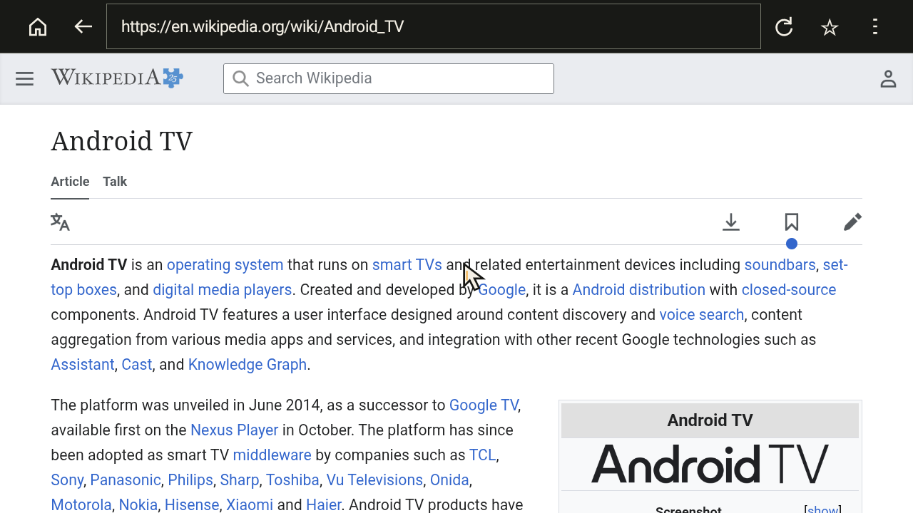
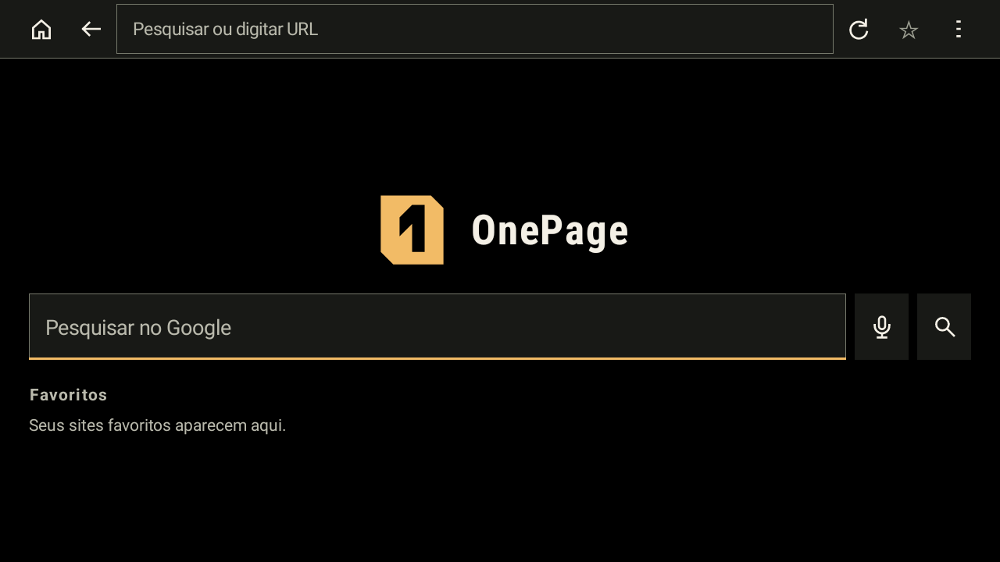
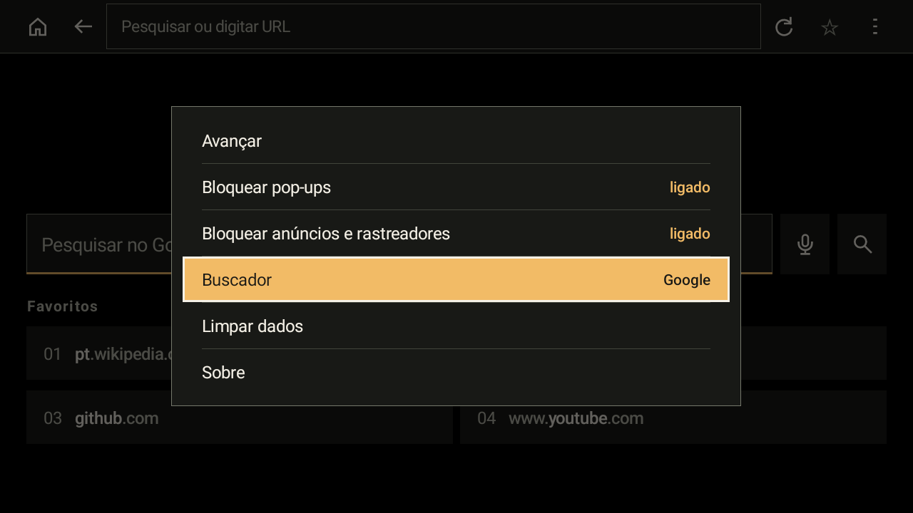

<div align="center">


# OnePage

### Browse the web with your TV remote.

One tab, built-in ad blocking and a pointer that moves with the D-pad.
Open your favorite sites on the big screen, without a mouse or an account.

<p>
  <a href="https://github.com/lucaswotta/onepage/releases/latest/download/OnePage-universal.apk"></a>
  <a href="https://github.com/lucaswotta/onepage/releases/latest/download/OnePage-armeabi-v7a.apk"></a>
</p>

Android 6.0+ · Free and open source · [Português](README.pt-BR.md)

[Install](#install) · [Features](#made-for-the-big-screen) · [Latest release](https://github.com/lucaswotta/onepage/releases/latest)



</div>

## Made for the big screen

- Navigate with your remote. Move the pointer with the D-pad, click with OK and scroll at the screen edges.
- Browse with fewer interruptions. Block ads and trackers, confirm pop-ups and keep browsing in one tab.
- Keep your sites close. Save favorites with their titles, then hold OK to reorder or remove them.
- Find your way through a page. Search its text, jump a screen at a time or go straight to the top or bottom.
- Control playback. Use play, pause, rewind and fast-forward on the remote.
- Make it fit. Choose your search engine, text size, desktop site view and screen margins.

| Your starting point | Everything within reach |
| --- | --- |
|  |  |

The interface is available in English, Spanish and Brazilian Portuguese. It also works on Android phones and tablets.

## Install

1. Download an APK below. If you are unsure which one to choose, use the universal build.
2. Open it on your Android TV and allow installation from the app you used to download it.
3. Launch OnePage and enter a site or search from the home screen.

| Download | Device |
| --- | --- |
| [TV APK · 32-bit ARM](https://github.com/lucaswotta/onepage/releases/latest/download/OnePage-armeabi-v7a.apk) | Recommended for low-memory TV sticks and boxes |
| [Universal APK](https://github.com/lucaswotta/onepage/releases/latest/download/OnePage-universal.apk) | All supported architectures |
| [64-bit ARM APK](https://github.com/lucaswotta/onepage/releases/latest/download/OnePage-arm64-v8a.apk) | Devices with a 64-bit Android system |
| [x86_64 APK](https://github.com/lucaswotta/onepage/releases/latest/download/OnePage-x86_64.apk) | Waydroid, emulators and x86_64 devices |

### Download directly on the TV

Open [Downloader by AFTVnews](https://play.google.com/store/apps/details?id=com.esaba.downloader) and enter:

```text
https://github.com/lucaswotta/onepage/releases/latest/download/OnePage-armeabi-v7a.apk
```

For automatic update notifications, [add OnePage to Obtainium](https://apps.obtainium.imranr.dev/redirect?r=obtainium://add/https://github.com/lucaswotta/onepage).

Moving from WebMini? OnePage installs as a separate app. Add your favorites in OnePage before removing WebMini.

## Start with these controls

| Remote | Action |
| --- | --- |
| D-pad + OK | Move the pointer and click |
| Up at the top of a page | Reach the address bar and toolbar |
| Back | Leave a field, close a menu or return to the previous page |
| Hold OK on a favorite | Open its actions |
| Page / channel keys | Jump through a long page |
| Media keys | Play, pause or seek 10 seconds |

## Explore the project

[Release notes](CHANGELOG.md) · [Technical guide](docs/technical-guide.md) · [Build and tests](docs/technical-guide.md#build-from-source) · [Roadmap](docs/ROADMAP.md) · [Report a bug](https://github.com/lucaswotta/onepage/issues/new/choose)

Contributions and [device reports](https://github.com/lucaswotta/onepage/issues/new?template=device-report.yml) help OnePage work on more TVs. The app is released under the [MIT License](LICENSE).
