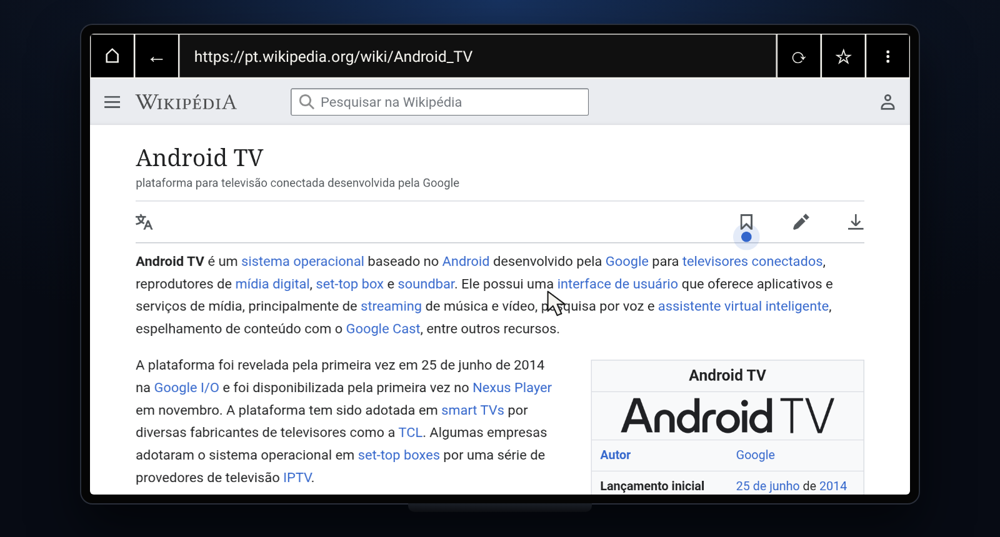
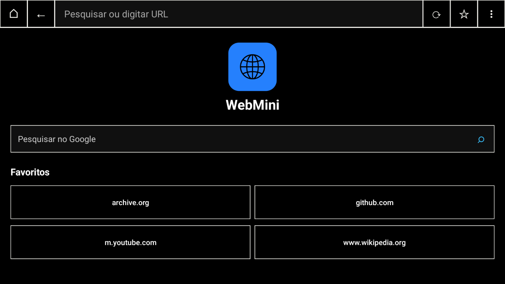
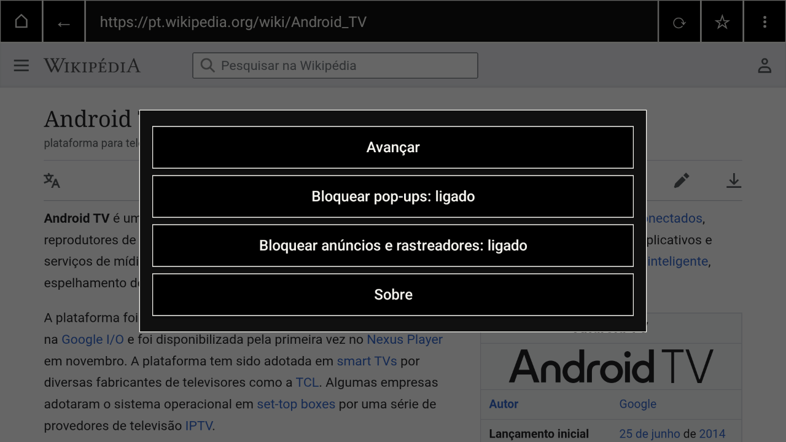
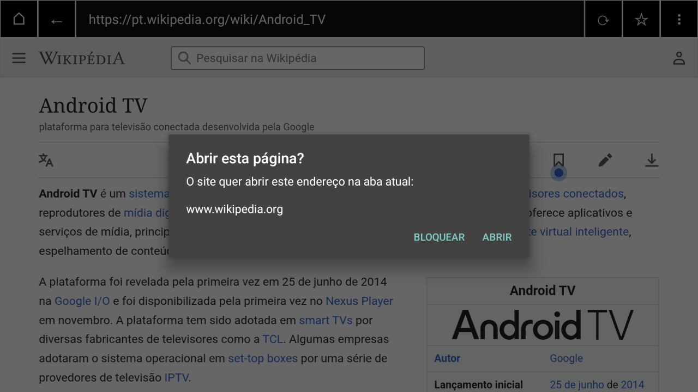
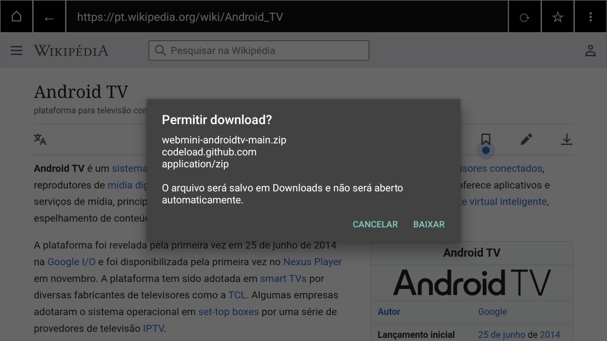
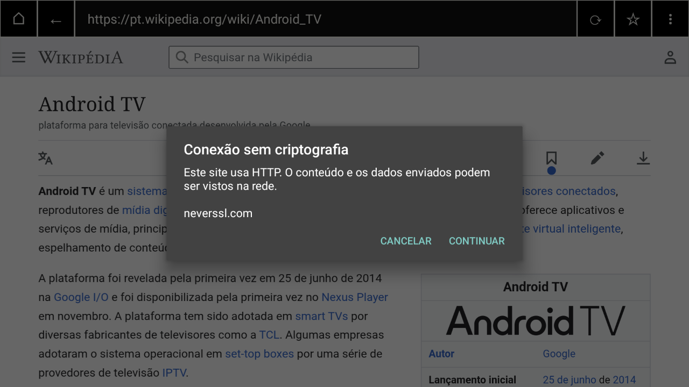

<div align="center">


# WebMini

A lightweight, single-tab web browser for Android TV that blocks ads, trackers and pop-ups.

[](https://github.com/lucaswotta/webmini-androidtv/releases/latest)
[](https://github.com/lucaswotta/webmini-androidtv/actions/workflows/build.yml)
[](#requirements)
[](LICENSE)

[Download](#install) · [Features](#features) · [Remote control](#remote-control) · [Privacy](#privacy) · [Build](#build) · [Português](README.pt-BR.md)



</div>

## Why WebMini

People who open a browser on a TV want to reach one site, read it or press play, and go back to the couch. Most pages are built for a mouse and a desktop ad budget: pop-ups, redirects to other apps, autoplaying ads and trackers that a TV remote cannot fight.

WebMini keeps one page open at a time and filters the rest:

- Network filtering with [`adblock-rust`](https://github.com/brave/adblock-rust), the engine used by the Brave browser, loaded with EasyList and EasyPrivacy.
- No new windows. A pop-up opens only after you confirm it, in the same tab.
- Pages cannot launch other apps or the Play Store (`intent://`, `market://` and every scheme other than `http` and `https`).
- A confirmation before every HTTP page and every download.
- 1.8 MB APK for 32-bit ARM TVs, with no tabs, accounts, sync, history or telemetry to carry.

Measured on a TiVo Stream 4K (Android 12, 2 GB RAM) on 2026-10-24, loading the `uol.com.br` home page for 30 s with the cache disabled, three runs each:

| | Requests | Data transferred | Hosts contacted |
| --- | ---: | ---: | ---: |
| Filtering off | 230–265 | 2.9–3.2 MB | 64–92 |
| Filtering on | 115 | 1.2 MB | 19 |

Cold start on the same device: 0.7–1.4 s to the home screen.

## Screenshots

| Home and favorites | Options |
| --- | --- |
|  |  |
| Pop-up confirmation | Download confirmation |
|  |  |
| HTTP warning | |
|  | |

The interface follows the device language: English, Spanish or Brazilian Portuguese. The screenshots show the Portuguese interface.

## Install

WebMini is distributed as APK files on the [releases page](https://github.com/lucaswotta/webmini-androidtv/releases/latest).

| File | Use it for |
| --- | --- |
| `WebMini-universal.apk` | Any device. Pick this one if you are not sure. |
| `WebMini-armeabi-v7a.apk` | 32-bit ARM. Most TV sticks and boxes, including 64-bit chips that run a 32-bit system. |
| `WebMini-arm64-v8a.apk` | 64-bit ARM systems. |
| `WebMini-x86_64.apk` | Android TV emulator and x86 devices. |

To find your device's architecture, run `adb shell getprop ro.product.cpu.abilist`. The first value is the one to use.

### With the Downloader app

1. Install [Downloader by AFTVnews](https://play.google.com/store/apps/details?id=com.esaba.downloader) from the Play Store on the TV.
2. In the TV settings, allow Downloader to install unknown apps.
3. Open Downloader and enter:

   ```text
   https://github.com/lucaswotta/webmini-androidtv/releases/latest/download/WebMini-universal.apk
   ```

4. Confirm the installation. WebMini appears in the apps row of the launcher.

### With ADB

Enable developer options and network debugging on the TV, then:

```sh
adb connect <tv-ip>:5555
adb install WebMini-universal.apk
```

WebMini registers as a browser, so links opened by other apps can open in it.

## Features

### Protection

| Threat | What WebMini does |
| --- | --- |
| Ads and trackers | Blocks matching network requests with EasyList and EasyPrivacy, including requests made by service workers. A short built-in host list covers the seconds while the lists load. |
| Pop-ups and new windows | Never opens a second window. A pop-up started by a click asks for confirmation and shows the destination host; one started by a script is discarded. |
| Redirects to other apps | Blocks navigation to any scheme other than `http` and `https`. |
| Unencrypted pages | Asks before loading any HTTP page, whether it comes from a link, a redirect, the address bar, a favorite or another app. Mixed content is never loaded. |
| Downloads | Shows file name, host and type before saving to Downloads. Files never open automatically. |
| Device access | Denies camera, microphone and location requests. File uploads and `file://` or `content://` access are blocked. |
| Malicious sites | Android System WebView Safe Browsing is on (Android 8.0 and later). |
| Crashed pages | Recovers when the page renderer stops, without closing the app. |

Filter lists are downloaded over HTTPS from `easylist.to`, refreshed every 7 days, limited to 5 MB each, checked for a valid header and replaced atomically. Both blocking options can be turned off from the options menu.

### Browsing

- Address bar that accepts a URL or a Google search.
- Back, forward, reload and home.
- Favorites on the home screen.
- Full-screen video.
- System light and dark themes on phones; a black interface on TV.

## Remote control

| Input | Action |
| --- | --- |
| D-pad | Moves the pointer. Holding a direction speeds it up. |
| Pointer at the top or bottom edge | Scrolls the page. |
| OK, Enter or gamepad A | Clicks under the pointer. |
| Back or gamepad B | Closes the menu, leaves full screen, or goes back one page. On the home screen, exits. |
| Left and right in a text field | Move the text cursor. |
| Gamepad analog stick | Moves the pointer. |

The pointer hides after 2.5 s without input and returns on the next key press.

## Privacy

WebMini has no analytics, telemetry, account or browsing history. The back stack lasts only for the current session.

Stored on the device, in the app's private storage:

- favorites and the two blocking options;
- the cached EasyList and EasyPrivacy files;
- cookies, cache and site storage, managed by Android System WebView. Third-party cookies are refused.

App data is excluded from cloud backup, device-to-device transfer and `adb backup`. To erase everything, open Settings > Apps > WebMini > Clear storage.

Requests made outside the pages you visit:

- `easylist.to`, at most once every 7 days, while ad blocking is on;
- Google Safe Browsing, through Android System WebView, on Android 8.0 and later;
- `google.com`, when you search from the home screen or the address bar.

## Limitations

- Filtering acts on network requests only. Blocked ads can leave empty space on the page, and ads served by the site itself, including YouTube video ads, are not removed.
- Sites can detect that requests were blocked.
- No regional filter lists are included. Sites in languages other than English rely on EasyList's generic rules.
- The search engine is fixed to Google.
- WebMini does not make browsing anonymous.

## Requirements

- Android 6.0 (API 23) or later, on TV, phone or tablet.
- Android System WebView, preinstalled on Android TV.

## Tested devices

| Device | System | Architecture | WebView | Result |
| --- | --- | --- | --- | --- |
| TiVo Stream 4K | Android TV 12 | `armeabi-v7a` | 155 | Works |

Running WebMini on another device? [Open a device report](https://github.com/lucaswotta/webmini-androidtv/issues/new?template=device-report.yml) with the model and what worked, so this table can grow.

## Build

Requirements: JDK 17 or later, Android SDK Platform 36, Android NDK 27.2.12479018, Rust and [`cargo-ndk`](https://github.com/bbqsrc/cargo-ndk).

```sh
rustup target add aarch64-linux-android armv7-linux-androideabi x86_64-linux-android
cargo install cargo-ndk --locked
export ANDROID_HOME=/path/to/android/sdk
./gradlew :app:assembleDebug
```

The build compiles the Rust filter for the three architectures, then writes one APK per architecture plus a universal APK to `app/build/outputs/apk/debug/`. Debug builds use the application ID `io.github.lucaswotta.webmini.debug`, so they install next to the release.

Release builds are signed when these Gradle properties are set, for example in `~/.gradle/gradle.properties`:

```properties
webminiStoreFile=/path/to/release.jks
webminiStorePassword=...
webminiKeyAlias=...
webminiKeyPassword=...
```

```sh
./gradlew :app:assembleRelease
```

Without them, `assembleRelease` produces unsigned APKs.

### Project layout

| Path | Contents |
| --- | --- |
| `app/src/main/java/io/github/lucaswotta/webmini/MainActivity.java` | The whole browser: interface, TV pointer, WebView policies, filter list updates. |
| `native/adblock/src/lib.rs` | JNI bridge to `adblock-rust`. |
| `app/src/main/res/` | Strings in English, Spanish and Portuguese; icons and TV banner. |
| `docs/brand/webmini-mark.svg` | Logo source. |

## Release signing certificate

Release APKs are signed with this certificate. Android refuses updates signed with a different key.

```text
SHA-256: AB:E8:D3:13:DC:19:19:CB:B4:6A:E4:9B:DC:CF:2C:BC:35:37:66:AF:2A:B3:FD:25:5B:3B:B2:90:39:14:57:37
```

Check a downloaded file with `apksigner verify --print-certs WebMini-universal.apk`.

## Contributing

Bug reports, device reports and pull requests are welcome. See [`SECURITY.md`](SECURITY.md) to report a vulnerability privately.

## License

WebMini is released under the [MIT License](LICENSE). The bundled `adblock-rust` component is licensed under MPL-2.0; its license ships in the app at `app/src/main/assets/MPL-2.0.txt`. EasyList and EasyPrivacy are downloaded at run time and are not part of this repository.
