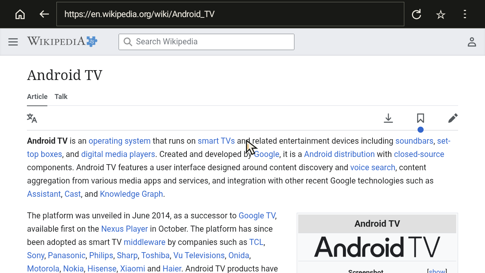
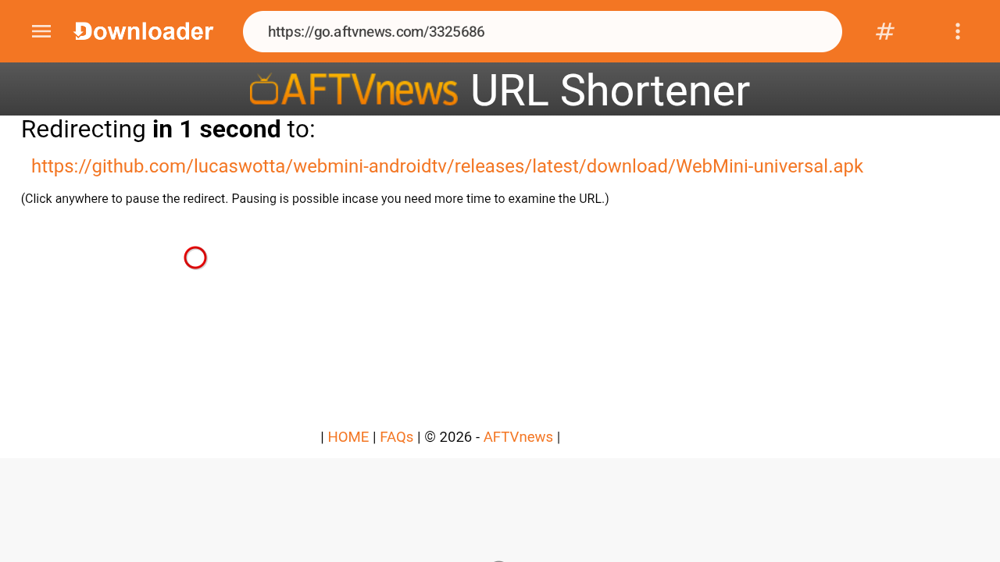
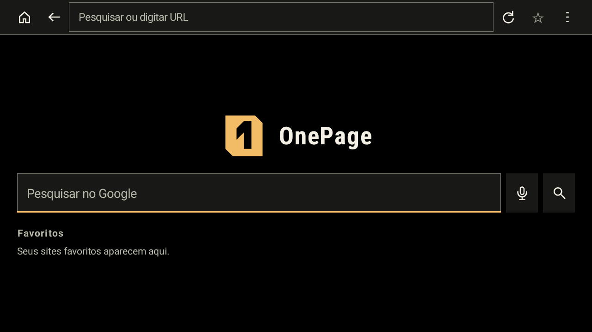
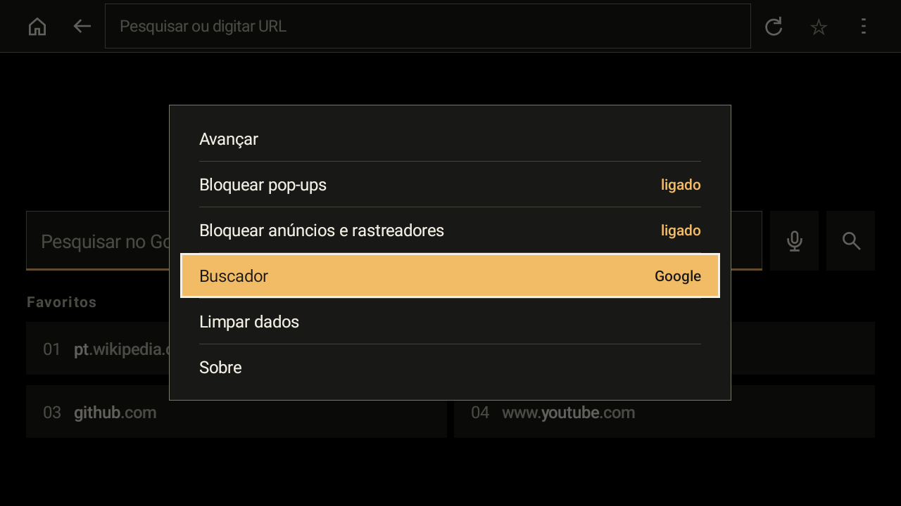
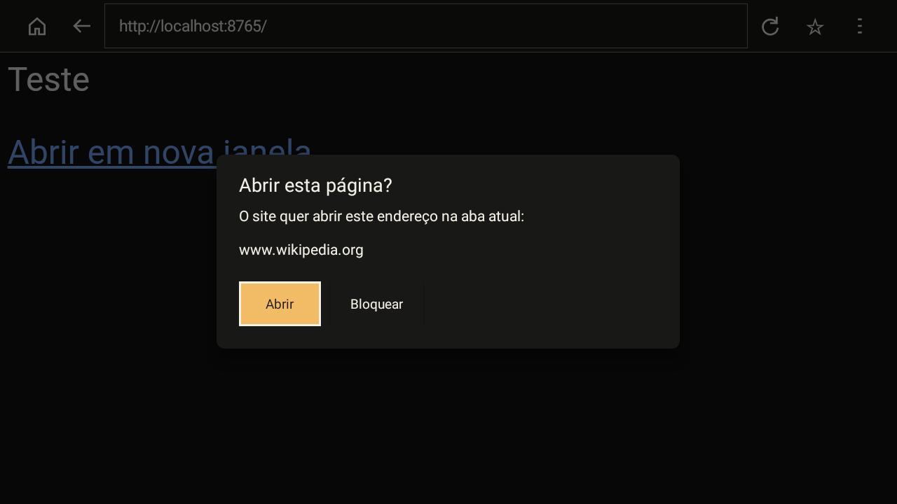
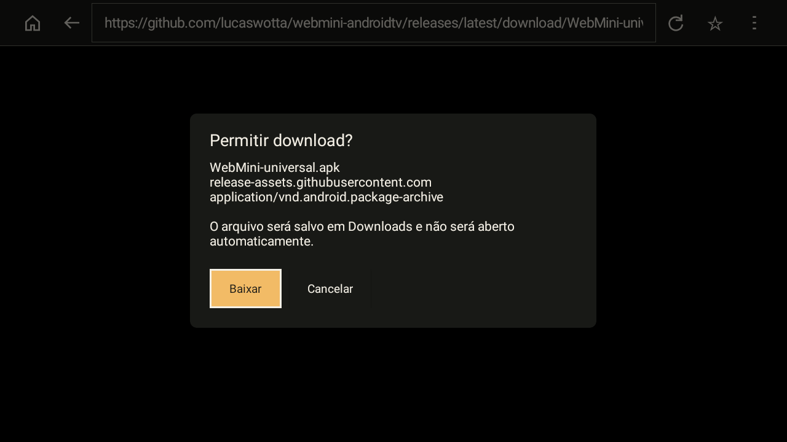
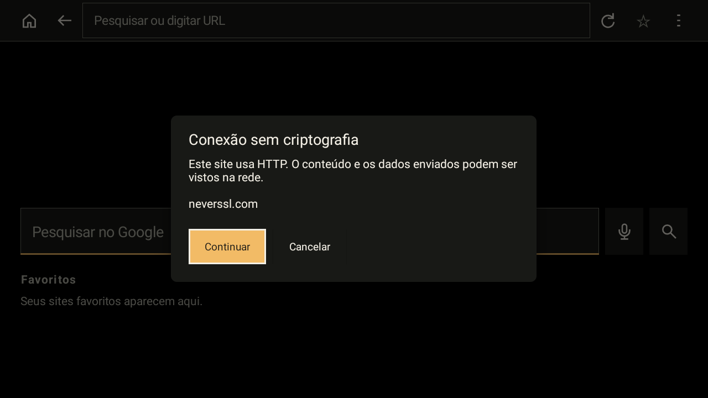
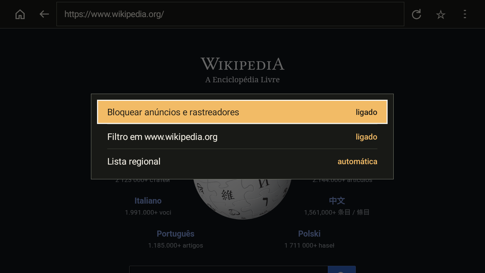

<div align="center">


# OnePage

Navegador de aba única para Android TV que bloqueia anúncios, rastreadores e pop-ups e funciona inteiro pelo controle remoto.

[English](README.md)



</div>

## Por quê

Quem abre um navegador na TV quer chegar a um site, ler ou dar play, e voltar para o sofá. A maioria das páginas foi feita para mouse e traz pop-ups, redirecionamentos para outros apps e rastreadores que o controle remoto não consegue enfrentar. O OnePage mantém uma página aberta e filtra o resto.

- Anúncios e rastreadores são barrados na rede pelo [`adblock-rust`](https://github.com/brave/adblock-rust), o motor do navegador Brave, com EasyList e EasyPrivacy. Carregar a página inicial do `uol.com.br` por 30 s gerou 115 requisições a 19 hosts (1,2 MB) com o filtro ligado, contra 230 a 265 requisições a 64 a 92 hosts (2,9 a 3,2 MB) com ele desligado.
- O app ocupa 63,3 MB de memória (PSS) na tela inicial, dos quais 11,2 MB de heap nativo. A versão 0.3.1 ocupava 70,6 MB e 15,4 MB.
- O motor de filtro compilado fica gravado em disco e recarrega em 0,14 s na abertura seguinte. Compilar a partir das listas leva 0,56 s e só acontece quando o app ou uma lista muda.
- Uma aba, nenhuma segunda janela. Páginas não abrem outros apps nem a Play Store, e toda página HTTP, todo pop-up e todo download pedem confirmação.
- Sem conta, sincronização, histórico, telemetria ou serviço em segundo plano.

Os números de memória e do motor foram medidos num TiVo Stream 4K (Android TV 12, 2 GB de RAM, `armeabi-v7a`) com build debug em 11/11/2026. Os de requisições foram medidos no mesmo aparelho com a versão 0.2.0 em 24/10/2026, cache desligado, três rodadas de cada. O método está em [`docs/testing.md`](docs/testing.md).

## Instalação

Requisitos: Android 6.0 (API 23) ou superior e a WebView do Android, que já vem instalada no Android TV. O OnePage também roda em celular e tablet.

Os arquivos APK ficam na [página de releases](https://github.com/lucaswotta/onepage/releases/latest).

| Arquivo | Para quem |
| --- | --- |
| `OnePage-armeabi-v7a.apk` | Recomendado para TVs. ARM de 32 bits, para sticks e boxes com pouca RAM, inclusive chips de 64 bits que rodam sistema de 32 bits. |
| `OnePage-universal.apk` | Qualquer aparelho. Use em sistemas só de 64 bits ou se não tiver certeza. |
| `OnePage-arm64-v8a.apk` | Sistemas ARM de 64 bits. |
| `OnePage-x86_64.apk` | Emulador de Android TV e aparelhos x86. |

`adb shell getprop ro.product.cpu.abilist` mostra as arquiteturas que o aparelho aceita.

### Pelo app Downloader

1. Instale o [Downloader by AFTVnews](https://play.google.com/store/apps/details?id=com.esaba.downloader) pela Play Store da TV.
2. Nas configurações da TV, permita que o Downloader instale apps desconhecidos.
3. Abra o Downloader e digite este endereço:

   ```text
   https://github.com/lucaswotta/onepage/releases/latest/download/OnePage-armeabi-v7a.apk
   ```

   Em sistema só de 64 bits, use o build universal:

   ```text
   https://github.com/lucaswotta/onepage/releases/latest/download/OnePage-universal.apk
   ```

   

4. Confirme a instalação. O OnePage aparece na fileira de apps do launcher.

### Pelo Obtainium

[Adicione o OnePage ao Obtainium](https://apps.obtainium.imranr.dev/redirect?r=obtainium://add/https://github.com/lucaswotta/onepage). O Obtainium acompanha as releases e avisa quando sai uma atualização.

### Pelo ADB

Ative as opções do desenvolvedor e a depuração pela rede na TV, depois:

```sh
adb connect <ip-da-tv>:5555
adb install -r OnePage-armeabi-v7a.apk
```

`-r` atualiza uma cópia instalada e preserva os dados. O APK precisa trazer o certificado de [Certificado de assinatura](#certificado-de-assinatura), ou o Android recusa a atualização.

### Para quem usava o WebMini

O OnePage se chamava WebMini até a versão 0.3.1. O application ID mudou junto com o nome, então o OnePage é instalado ao lado do WebMini em vez de atualizá-lo. Favoritos e opções não são levados: adicione os favoritos de novo, à mão, no OnePage e depois desinstale o WebMini.

## Uso com o controle remoto

| Entrada | Ação |
| --- | --- |
| Direcional | Move o foco na tela inicial e nos menus; na página, move o ponteiro. Segurar a direção acelera o ponteiro. |
| Ponteiro numa borda da tela | Rola a página para cima, baixo, esquerda ou direita, mais rápido quanto mais tempo ficar ali. |
| OK, Enter ou botão A do gamepad | Clica sob o ponteiro. Na barra de endereço, abre o teclado. |
| Cima no topo da página | Leva o foco à barra de ferramentas, na barra de endereço, com o endereço atual selecionado. Esquerda e direita passam pelos botões. |
| Baixo na barra de ferramentas | Volta ao ponteiro. |
| Segurar OK num favorito | Abre as opções Abrir, Mover para antes, Mover para depois e Remover daquele favorito. |
| Page Up, Page Down, Canal + e Canal - | Movem a página uma tela. Em controles sem essas teclas, Menu > Ir para oferece Topo, Uma tela acima, Uma tela abaixo e Fim. |
| Play/pause, retroceder e avançar | Agem no vídeo da página; retroceder e avançar pulam 10 s. |
| Voltar ou botão B do gamepad | Fecha o menu ou o campo em foco, sai da barra de ferramentas e da tela cheia e depois volta uma página. Na tela inicial, sai do app. |
| Esquerda e direita num campo de texto | Movem o cursor do texto ou deixam o campo nas pontas do texto. |
| Analógico do gamepad | Move o ponteiro nas páginas. |

O ponteiro some depois de 2,5 s sem uso e volta na próxima tecla. Enquanto um campo de texto da página está com o teclado, o direcional e as teclas de página vão para o campo; use Voltar para sair dele e então Cima alcança a barra de ferramentas.

## Recursos

| Início e favoritos | Opções |
| --- | --- |
|  |  |
| Confirmação de pop-up | Confirmação de download |
|  |  |
| Aviso de HTTP | Opções do bloqueio de anúncios |
|  |  |

A interface segue o idioma do aparelho: inglês, espanhol ou português do Brasil.

### Navegação

- Barra de endereço que aceita URL ou pesquisa, com Google, DuckDuckGo, Bing ou Brave como buscador.
- Pesquisa por voz com o microfone do controle, feita pelo reconhecedor de fala instalado no aparelho.
- Voltar, avançar, recarregar e início.
- Localizar na página, em Menu > Localizar na página, com resultado anterior e próximo.
- Até 4 favoritos na tela inicial, mostrados com o título da página, para a tela inicial caber sem rolagem. Com a grade cheia, a estrela lista os favoritos para substituir um.
- Menu > Preferências: buscador, site para computador (envia o user agent do Chrome de computador e recarrega), tamanho do texto (100, 125 ou 150%) e margem da tela (0, 2, 4 ou 6%) para TVs que cortam as bordas da imagem.
- Endereços locais digitados sem esquema (`localhost:8080`, `192.168.0.10`) abrem por HTTP, com o aviso de HTTP.
- Vídeo em tela cheia.
- Respostas de erro HTTP (404, 500 e outras) mostram a página do próprio servidor. A tela de erro só aparece quando a conexão falha e oferece recarregar, editar o endereço e início.
- Quando o Android encerra o processo da página, o app continua aberto e oferece recarregá-la. Quando o Android mata o app em segundo plano, a página reabre na mesma posição de rolagem.
- O OnePage se registra como navegador, então links abertos por outros apps podem abrir nele.

### Bloqueio de anúncios

- As requisições de rede são comparadas com EasyList e EasyPrivacy, inclusive as feitas por service workers. Uma lista regional para português ou espanhol é escolhida pelo idioma do aparelho ou em Menu > Bloquear anúncios e rastreadores > Lista regional.
- A primeira página espera até 6 s pelo motor de filtro e avisa disso. Se o motor não ficar pronto nesse tempo, a página abre com um aviso e bloqueio reduzido.
- Um script que redireciona a aba atual para um host das listas de filtro é barrado, com aviso.
- "Filtro neste site", no mesmo menu, isenta o site atual até o app fechar.
- O menu mostra quantas requisições foram bloqueadas na página atual, por exemplo "ligado (23)", e o estado do motor enquanto as listas carregam.
- As listas são baixadas por HTTPS de `easylist.to` e `easylist-downloads.adblockplus.org`, atualizadas a cada 7 dias, limitadas a 5 MB cada, conferidas pelo cabeçalho e substituídas de forma atômica. A atualização envia `ETag` e `Last-Modified`, então uma lista sem mudança custa uma resposta `304` e nenhuma recompilação.
- Um aviso aparece uma vez por versão da WebView quando a WebView do Android está abaixo do Chromium 80, em que o bloqueio fica incompleto.

## Privacidade e segurança

O OnePage não tem analytics, telemetria, conta nem histórico de navegação. A pilha de voltar dura só a sessão atual.

| Ameaça | O que o OnePage faz |
| --- | --- |
| Pop-ups e janelas novas | Nunca abre uma segunda janela. Pop-up iniciado por clique pede confirmação e mostra o endereço que o script realmente abre; pop-up iniciado sem clique é descartado. |
| Redirecionamento para outros apps | Bloqueia navegação para qualquer esquema que não seja `http` ou `https`, inclusive `intent://` e `market://`. |
| Páginas sem criptografia | Pergunta antes de carregar qualquer página HTTP aberta por GET, venha ela de link, redirecionamento, barra de endereço, favorito ou outro app. Formulários enviados por HTTP são bloqueados. Conteúdo misto nunca carrega. |
| Downloads | Mostra nome do arquivo, host e tipo antes de salvar em Downloads. Arquivos nunca abrem sozinhos. O `Referer` enviado segue `strict-origin-when-cross-origin`. |
| Acesso ao aparelho | Nega pedidos de câmera, microfone e localização. Envio de arquivos e acesso a `file://` ou `content://` ficam bloqueados. |
| Sites maliciosos | O Safe Browsing da WebView do Android fica ligado (Android 8.0 ou superior). |

Fica guardado no aparelho, no armazenamento privado do app:

- preferências e favoritos;
- os arquivos das listas de filtro e o motor compilado (`engine.dat`);
- cookies e armazenamento dos sites, geridos pela WebView do Android. Cookies de terceiros são recusados;
- o cache das páginas, mantido entre as sessões.

Menu > Limpar dados apaga o cache, os cookies e dados de sites, ou os dois. Os dados do app ficam fora do backup na nuvem, da transferência entre aparelhos e do `adb backup`. Para apagar tudo, abra Configurações > Apps > OnePage > Limpar armazenamento.

Requisições feitas fora das páginas que você visita:

- `easylist.to` e, quando uma lista regional está ativa, `easylist-downloads.adblockplus.org`, a cada 7 dias com o bloqueio de anúncios ligado. Uma lista que falha é tentada de novo na próxima abertura;
- Google Safe Browsing, pela WebView do Android, no Android 8.0 ou superior;
- o buscador escolhido, quando você pesquisa pela tela inicial ou pela barra de endereço;
- o reconhecedor de fala instalado no aparelho, quando você usa a pesquisa por voz.

### Certificado de assinatura

Os APKs de release são assinados com este certificado, o mesmo das releases do WebMini. O Android recusa atualizações assinadas com outra chave.

```text
SHA-256: AB:E8:D3:13:DC:19:19:CB:B4:6A:E4:9B:DC:CF:2C:BC:35:37:66:AF:2A:B3:FD:25:5B:3B:B2:90:39:14:57:37
```

Confira um arquivo baixado com `apksigner verify --print-certs OnePage-armeabi-v7a.apk` e o hash dele com o `SHA256SUMS.txt` da mesma release.

Para relatar uma vulnerabilidade em privado, veja o [`SECURITY.md`](SECURITY.md).

## Compilar a partir do código

Requisitos: JDK 17 ou superior, Android SDK Platform 36, Android NDK 27.2.12479018, Rust 1.99.1 e [`cargo-ndk`](https://github.com/bbqsrc/cargo-ndk) 4.1.2. A CI usa as mesmas versões.

```sh
rustup toolchain install 1.99.1 --profile minimal
rustup default 1.99.1
rustup target add aarch64-linux-android armv7-linux-androideabi x86_64-linux-android
cargo install cargo-ndk --locked --version 4.1.2
export ANDROID_HOME=/caminho/do/android/sdk
./gradlew :app:assembleDebug
```

O build compila o filtro em Rust (`libonepage_adblock.so`) para as três arquiteturas e grava um APK por arquitetura, mais um universal, em `app/build/outputs/apk/debug/`. O build debug usa o application ID `io.github.lucaswotta.onepage.debug` e instala ao lado da release.

O build release é assinado quando estas propriedades do Gradle estão definidas, por exemplo em `~/.gradle/gradle.properties`. Os nomes das propriedades mantêm o prefixo `webmini` de antes da mudança de nome:

```properties
webminiStoreFile=/caminho/release.jks
webminiStorePassword=...
webminiKeyAlias=...
webminiKeyPassword=...
```

```sh
./gradlew :app:assembleRelease
```

Sem elas, `assembleRelease` gera APKs sem assinatura.

`./gradlew :app:testDebugUnitTest :app:lintRelease` roda os testes unitários e o lint. O checklist manual e a matriz de aparelhos estão em [`docs/testing.md`](docs/testing.md).

A integração contínua roda as mesmas tarefas, compila as duas variantes a cada push na `main` e a cada pull request e confere que cada APK release traz a `libonepage_adblock.so` correspondente. Os workflows fixam Rust, cargo-ndk e cada action pelo SHA do commit, e o wrapper do Gradle verifica o SHA-256 da sua distribuição.

Publicar uma tag `v*` executa `.github/workflows/release.yml`: ele recusa tag que não bate com `versionName`, compila uma release assinada, confere cada APK contra o digesto do certificado acima, renomeia os arquivos para `OnePage-{universal,armeabi-v7a,arm64-v8a,x86_64}.apk`, grava `SHA256SUMS.txt` e anexa tudo à página da release. A assinatura lê os secrets do repositório `WEBMINI_KEYSTORE_BASE64` (o keystore codificado com `base64 -w0`), `WEBMINI_STORE_PASSWORD`, `WEBMINI_KEY_ALIAS` e `WEBMINI_KEY_PASSWORD`. O workflow só roda quando a variável do repositório `WEBMINI_CI_RELEASE` é `true`; fora disso, as releases são compiladas e publicadas de uma máquina local.

Relatos de bug, [relatos de aparelho](https://github.com/lucaswotta/onepage/issues/new?template=device-report.yml) e pull requests são bem-vindos. O trabalho planejado está em [`docs/ROADMAP.md`](docs/ROADMAP.md) e as mudanças lançadas em [`CHANGELOG.md`](CHANGELOG.md).

## Limitações

- O filtro age só nas requisições de rede. Anúncios bloqueados podem deixar espaço vazio na página, e anúncios servidos pelo próprio site, inclusive os de vídeo do YouTube, não são removidos.
- Sites podem detectar que requisições foram bloqueadas.
- A WebView do Android não repassa todas as requisições ao filtro: o interceptador vê a primeira URL de um recurso redirecionado e não cobre tudo o que um navegador com pilha de rede própria cobre. Um formulário POST para um endereço HTTP é bloqueado em vez de confirmado, porque a WebView não informa navegações POST ao callback que mostra o aviso.
- Há listas regionais para português e espanhol. Outros idiomas dependem das regras genéricas da EasyList.
- Mídia protegida (EME, usada por serviços de streaming pagos) não é suportada.
- A tela inicial mostra 4 favoritos.
- Testado em um aparelho: TiVo Stream 4K, Android TV 12, `armeabi-v7a`, WebView 155. O Android 6.0 é a versão mínima suportada e não foi executado em aparelho.
- O OnePage não torna a navegação anônima.

## Licença

O OnePage é distribuído sob a [licença MIT](LICENSE). O componente `adblock-rust` embutido usa a licença MPL-2.0, incluída no app em `app/src/main/assets/MPL-2.0.txt`. EasyList e EasyPrivacy são baixadas durante o uso e não fazem parte deste repositório.
