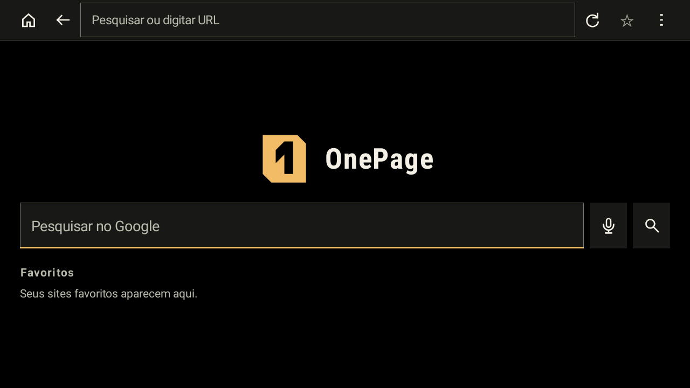
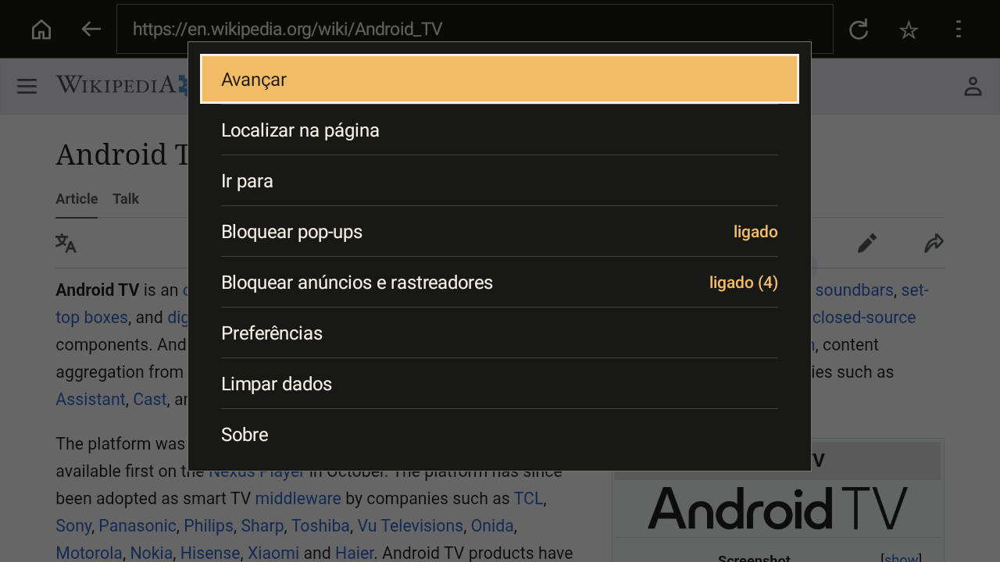
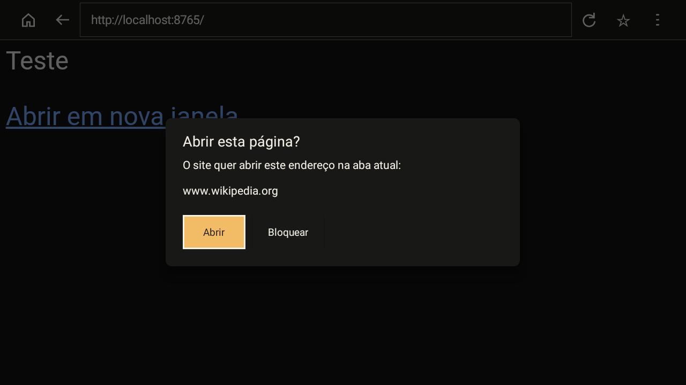
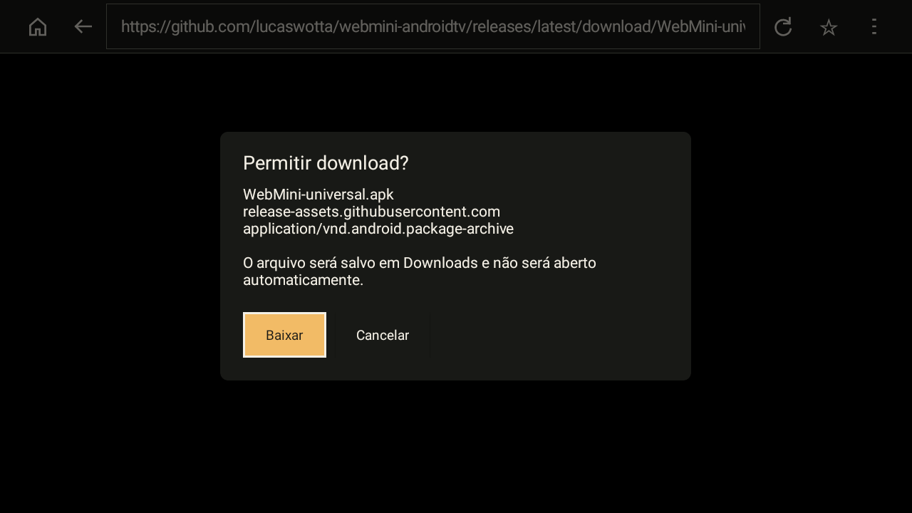
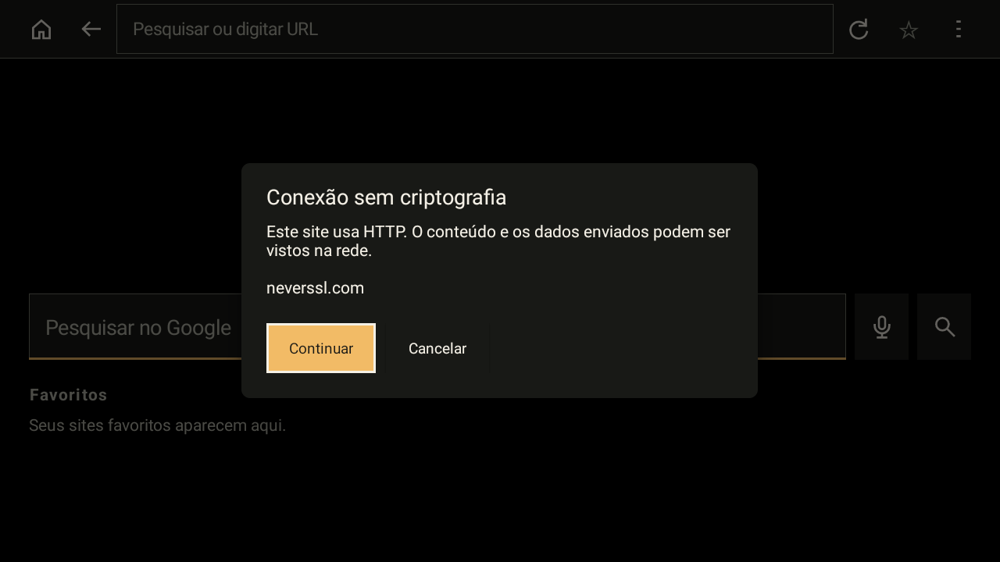
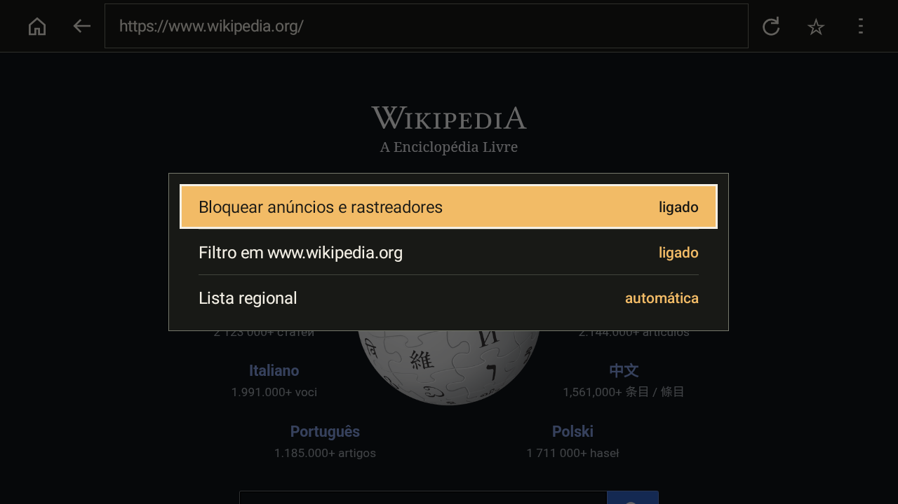

# Technical guide

## Install

Requirements: Android 6.0 (API 23) or later and Android System WebView, which is preinstalled on Android TV. OnePage also runs on phones and tablets.

Choose a download below. If you do not know your device architecture, use the universal APK.

| File | Use it for |
| --- | --- |
| [OnePage-armeabi-v7a.apk](https://github.com/lucaswotta/onepage/releases/latest/download/OnePage-armeabi-v7a.apk) | Recommended for TVs. 32-bit ARM, for low-RAM sticks and boxes, including 64-bit chips that run a 32-bit system. |
| [OnePage-universal.apk](https://github.com/lucaswotta/onepage/releases/latest/download/OnePage-universal.apk) | Any device. Use it on 64-bit-only systems or when you are not sure. |
| [OnePage-arm64-v8a.apk](https://github.com/lucaswotta/onepage/releases/latest/download/OnePage-arm64-v8a.apk) | 64-bit ARM systems. |
| [OnePage-x86_64.apk](https://github.com/lucaswotta/onepage/releases/latest/download/OnePage-x86_64.apk) | Android TV emulator and x86 devices. |

`adb shell getprop ro.product.cpu.abilist` prints the architectures the device accepts.

### With the Downloader app

1. Install [Downloader by AFTVnews](https://play.google.com/store/apps/details?id=com.esaba.downloader) from the Play Store on the TV.
2. In the TV settings, allow Downloader to install unknown apps.
3. Open Downloader and enter this address:

   ```text
   https://github.com/lucaswotta/onepage/releases/latest/download/OnePage-armeabi-v7a.apk
   ```

   On a 64-bit-only system, use the universal build:

   ```text
   https://github.com/lucaswotta/onepage/releases/latest/download/OnePage-universal.apk
   ```


4. Confirm the installation. OnePage appears in the apps row of the launcher.

### With Obtainium

[Add OnePage to Obtainium](https://apps.obtainium.imranr.dev/redirect?r=obtainium://add/https://github.com/lucaswotta/onepage). Obtainium tracks the releases and notifies you when an update is available.

### With ADB

Enable developer options and network debugging on the TV, then:

```sh
adb connect <tv-ip>:5555
adb install -r OnePage-armeabi-v7a.apk
```

`-r` updates an installed copy and keeps its data. The APK must carry the certificate listed in [Release signing certificate](#release-signing-certificate), or Android rejects the update.

### Coming from WebMini

OnePage was called WebMini up to version 0.3.1. The application ID changed with the name, so OnePage installs next to WebMini instead of updating it. Favorites and options are not carried over: add the favorites again by hand in OnePage, then uninstall WebMini.

## Using the remote

| Input | Action |
| --- | --- |
| D-pad | Moves focus on the home screen and in menus; moves the pointer on web pages. Holding a direction speeds the pointer up. |
| Pointer at an edge of the screen | Scrolls the page up, down, left or right, faster the longer it stays there. |
| OK, Enter or gamepad A | Clicks under the pointer. In the address bar, opens the keyboard. |
| Up at the top of a page | Focuses the toolbar at the address bar, with the current address selected. Left and right move between the buttons. |
| Down in the toolbar | Returns to the pointer. |
| Hold OK on a favorite | Opens Open, Move earlier, Move later and Remove for that favorite. |
| Page Up, Page Down, Channel Up, Channel Down | Move the page one screen. Menu > Go to offers Top, Screen up, Screen down and Bottom for remotes without these keys. |
| Play/pause, rewind, fast-forward | Act on the page's video; rewind and fast-forward seek 10 s. |
| Back or gamepad B | Closes the menu or the focused field, leaves the toolbar and full screen, then goes back one page. On the home screen, exits. |
| Left and right in a text field | Move the text cursor, or leave the field at the ends of the text. |
| Gamepad analog stick | Moves the pointer on web pages. |

The pointer hides after 2.5 s without input and returns on the next key press. While a text field inside a page has the keyboard, the D-pad and the page keys go to the field; press Back to leave it, then up reaches the toolbar.

## Features

| Home and favorites | Options |
| --- | --- |
|  |  |
| Pop-up confirmation | Download confirmation |
|  |  |
| HTTP warning | Ad blocking options |
|  |  |

The interface follows the device language: English, Spanish or Brazilian Portuguese. The screenshots show the Portuguese interface.

### Browsing

- Address bar that accepts a URL or a search, with Google, DuckDuckGo, Bing or Brave as the search engine.
- Voice search with the remote microphone, performed by the speech recognizer installed on the device.
- Back, forward, reload and home.
- Find in page, from Menu > Find in page, with previous and next result.
- Up to 4 favorites on the home screen, shown with the page title, so the home screen fits without scrolling. With the grid full, the star lists the favorites so one can be replaced.
- Menu > Preferences: search engine, desktop site (sends a desktop Chrome user agent and reloads), text size (100, 125 or 150%) and screen margin (0, 2, 4 or 6%) for TVs that crop the picture edges.
- Local addresses typed without a scheme (`localhost:8080`, `192.168.0.10`) open over HTTP, with the HTTP warning.
- Full-screen video.
- HTTP error responses (404, 500 and others) show the server's own page. The error screen appears only when the connection fails, and offers reload, edit address and home.
- When Android stops the page renderer, the app stays open and offers to reload the page. When Android kills the app in the background, the page reopens at the same scroll position.
- OnePage registers as a browser, so links opened by other apps can open in it.

### Ad blocking

- Network requests are matched against EasyList and EasyPrivacy, including requests made by service workers. A regional list for Portuguese or Spanish is chosen by the device language or in Menu > Block ads and trackers > Regional list.
- The first page waits up to 6 s for the filter engine and says so. If the engine is not ready by then, the page opens with a notice and reduced blocking.
- A script that redirects the current tab to a host on the filter lists is stopped, with a notice.
- "Filter on this site" in the same menu exempts the current site until the app closes.
- The menu shows how many requests were blocked on the current page, for example "on (23)", and the engine state while lists load.
- Lists are downloaded over HTTPS from `easylist.to` and `easylist-downloads.adblockplus.org`, refreshed every 7 days, limited to 5 MB each, checked for a valid header and replaced atomically. An update sends `ETag` and `Last-Modified`, so an unchanged list costs one `304` response and no rebuild.
- A notice appears once per WebView version when Android System WebView is below Chromium 80, where blocking is incomplete.

## Privacy and security

OnePage has no analytics, telemetry, account or browsing history. The back stack lasts for the current session.

| Threat | What OnePage does |
| --- | --- |
| Pop-ups and new windows | Never opens a second window. A pop-up started by a click asks for confirmation and shows the address the script really opens; a pop-up started without a click is discarded. |
| Redirects to other apps | Blocks navigation to any scheme other than `http` and `https`, including `intent://` and `market://`. |
| Unencrypted pages | Asks before loading any HTTP page opened by GET, whether it comes from a link, a redirect, the address bar, a favorite or another app. Forms sent over HTTP are blocked. Mixed content is never loaded. |
| Downloads | Shows file name, host and type before saving to Downloads. Files never open automatically. The `Referer` sent follows `strict-origin-when-cross-origin`. |
| Device access | Denies camera, microphone and location requests. File uploads and `file://` or `content://` access are blocked. |
| Malicious sites | Android System WebView Safe Browsing is on (Android 8.0 and later). |

Stored on the device, in the app's private storage:

- preferences and favorites;
- the filter list files and the compiled engine (`engine.dat`);
- cookies and site storage, managed by Android System WebView. Third-party cookies are refused;
- the page cache, kept between sessions.

Menu > Clear data erases the cache, the cookies and site data, or both. App data is excluded from cloud backup, device-to-device transfer and `adb backup`. To erase everything, open Settings > Apps > OnePage > Clear storage.

Requests made outside the pages you visit:

- `easylist.to` and, when a regional list is enabled, `easylist-downloads.adblockplus.org`, every 7 days while ad blocking is on. A list that fails to download is retried on the next launch;
- Google Safe Browsing, through Android System WebView, on Android 8.0 and later;
- the chosen search engine, when you search from the home screen or the address bar;
- the speech recognizer installed on the device, when you use voice search.

### Release signing certificate

Release APKs are signed with this certificate, the same one used by WebMini releases. Android refuses updates signed with a different key.

```text
SHA-256: AB:E8:D3:13:DC:19:19:CB:B4:6A:E4:9B:DC:CF:2C:BC:35:37:66:AF:2A:B3:FD:25:5B:3B:B2:90:39:14:57:37
```

Check a downloaded file with `apksigner verify --print-certs OnePage-armeabi-v7a.apk`, and its hash against `SHA256SUMS.txt` from the same release.

To report a vulnerability privately, see [`SECURITY.md`](../SECURITY.md).

## Build from source

Requirements: JDK 17 or later, Android SDK Platform 36, Android NDK 27.2.12479018, Rust 1.99.1 and [`cargo-ndk`](https://github.com/bbqsrc/cargo-ndk) 4.1.2. CI uses the same versions.

```sh
rustup toolchain install 1.99.1 --profile minimal
rustup default 1.99.1
rustup target add aarch64-linux-android armv7-linux-androideabi x86_64-linux-android
cargo install cargo-ndk --locked --version 4.1.2
export ANDROID_HOME=/path/to/android/sdk
./gradlew :app:assembleDebug
```

The build compiles the Rust filter (`libonepage_adblock.so`) for the three architectures, then writes one APK per architecture plus a universal APK to `app/build/outputs/apk/debug/`. Debug builds use the application ID `io.github.lucaswotta.onepage.debug`, so they install next to the release.

Release builds are signed when these Gradle properties are set, for example in `~/.gradle/gradle.properties`. The property names keep the `webmini` prefix from before the rename:

```properties
webminiStoreFile=/path/to/release.jks
webminiStorePassword=...
webminiKeyAlias=...
webminiKeyPassword=...
```

```sh
./gradlew :app:assembleRelease
```

Without them, `assembleRelease` produces unsigned APKs.

`./gradlew :app:testDebugUnitTest :app:lintRelease` runs the unit tests and lint. The manual checklist and the device matrix are in [`testing.md`](testing.md).

Continuous integration runs the same tasks, builds both variants on every push to `main` and every pull request, and checks that each release APK carries the matching `libonepage_adblock.so`. The workflows pin Rust, cargo-ndk and each action by commit SHA, and the Gradle wrapper verifies the SHA-256 of its distribution.

Pushing a tag `v*` runs `.github/workflows/release.yml`: it refuses a tag that does not match `versionName`, builds a signed release, checks every APK against the certificate digest above, renames the files to `OnePage-{universal,armeabi-v7a,arm64-v8a,x86_64}.apk`, writes `SHA256SUMS.txt` and attaches them to the release page. Signing reads the repository secrets `WEBMINI_KEYSTORE_BASE64` (the keystore encoded with `base64 -w0`), `WEBMINI_STORE_PASSWORD`, `WEBMINI_KEY_ALIAS` and `WEBMINI_KEY_PASSWORD`. The workflow runs only when the repository variable `WEBMINI_CI_RELEASE` is `true`; otherwise releases are built and published from a local machine.

Bug reports, [device reports](https://github.com/lucaswotta/onepage/issues/new?template=device-report.yml) and pull requests are welcome. Planned work is in [`ROADMAP.md`](ROADMAP.md) and released changes in [`CHANGELOG.md`](../CHANGELOG.md).

## Limitations

- Filtering acts on network requests only. Blocked ads can leave empty space on the page, and ads served by the site itself, including YouTube video ads, are not removed.
- Sites can detect that requests were blocked.
- Android System WebView does not pass every request to the filter: the interceptor sees the first URL of a redirected resource and cannot cover everything a browser with its own network stack can. A POST form to an HTTP address is blocked instead of confirmed, because the WebView does not report POST navigations to the callback that shows the warning.
- Regional filter lists exist for Portuguese and Spanish. Other languages rely on EasyList's generic rules.
- Protected media (EME, used by paid streaming services) is not supported.
- The home screen shows 4 favorites.
- Validated on TiVo Stream 4K (Android TV 12, `armeabi-v7a`, WebView 156) and Waydroid (Android 13, `x86_64`, WebView 111). Android 6.0 is the minimum supported version and has not been run on a device.
- OnePage does not make browsing anonymous.

## License

OnePage is released under the [MIT License](../LICENSE). The bundled `adblock-rust` component is licensed under MPL-2.0; its license ships in the app at `app/src/main/assets/MPL-2.0.txt`. EasyList and EasyPrivacy are downloaded at run time and are not part of this repository.
